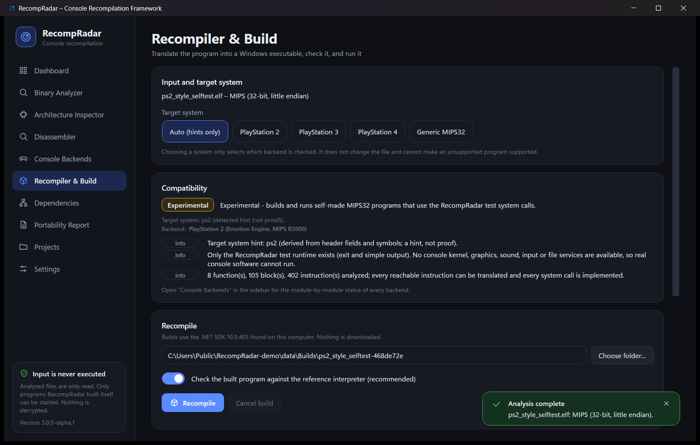
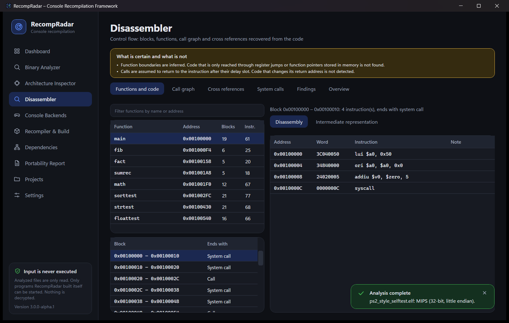
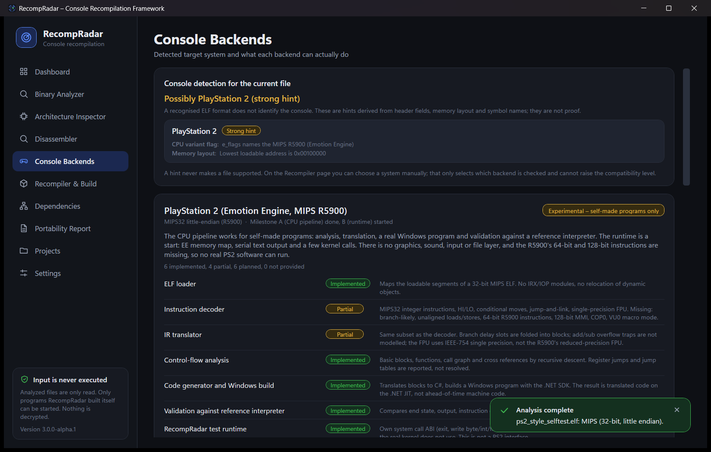
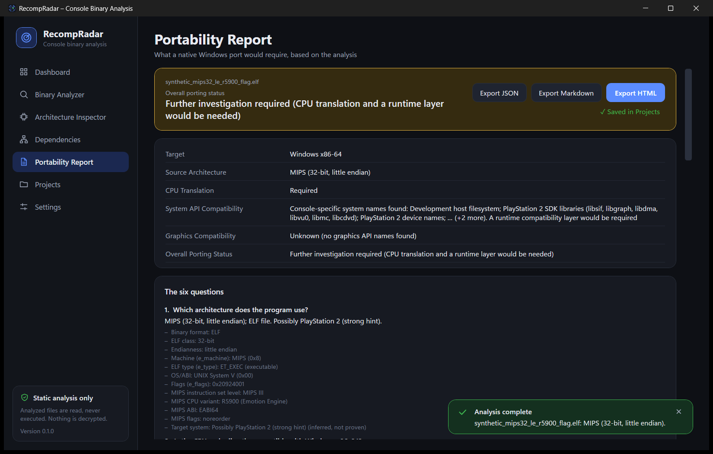

<p align="center">
  
</p>

<h1 align="center">RecompRadar</h1>
<p align="center"><strong>Console Binary Analysis and Recompilation Framework</strong></p>

RecompRadar inspects executable files of console programs and tells you, from facts found in the file, **what a native
Windows port would require**: which CPU architecture the code uses, whether it can run on a PC processor at all, which
libraries and APIs it refers to, and which information is still missing. Since version 3.0 it also contains a
**recompilation framework**: it can analyze the control flow of a 32-bit MIPS program, translate it into a real Windows
program, check that program against a reference interpreter, and start it.

> **What works today, in one paragraph.** A *self-made* MIPS32 program (the CPU family of the PlayStation 2) can be turned
> into a Windows `.exe`; RecompRadar proves for that run that the result behaves like a reference interpreter, and can
> start it. The built program is **translated code that runs on the .NET JIT** – it is labelled that way and is not
> presented as "native". The runtime is only a **first slice of the PlayStation 2** (memory map, serial text output, 18 kernel
> calls for threads and semaphores): there is no graphics, sound, controller or file layer, and the R5900's 64-bit instructions
> are missing, so **no commercial game can run**. PlayStation 3 and 4 support is planned, not implemented. RecompRadar does not decrypt,
> unpack or circumvent protection and ships no console keys, firmware, BIOS or game data.
> Full status and limits: [docs/recompilation.md](docs/recompilation.md).

<p align="center">
  
  
</p>
<p align="center">
  
  
</p>

All screenshots in this repository were produced by the real application with `tools/capture-screenshots.ps1`, using the
synthetic files from `samples/`. The Recompiler screenshot shows the state before a build.

## Contents

* [Features](#features) · [Recompilation framework](#recompilation-framework-milestone-a) · [What it does not do](#what-it-does-not-do) · [Supported formats](#supported-formats)
* [Install and run](#install-and-run) · [Build](#build) · [Tests](#tests)
* [Using the app](#using-the-app) · [How to read the results](#how-to-read-the-results)
* [Project architecture](#project-architecture) · [Technical limitations](#technical-limitations) · [Milestones and roadmap](#milestones-and-roadmap)
* [Safety and legal](#safety-and-legal) · [Kurzanleitung (Deutsch)](#kurzanleitung-deutsch)

## Features

Everything listed here is implemented and covered by automated tests.

**Binary Analyzer**
* Opens a file by dialog, drag and drop (onto any page or the whole window) or command line.
* Parses ELF32/ELF64, little and big endian: header, program headers (segments), section headers, `.symtab`/`.dynsym`
  symbols (type, binding, visibility, section), dynamic section (`DT_NEEDED`, `DT_SONAME`, `RPATH`/`RUNPATH`, interpreter),
  extended section numbering, entry point and where it lies.
* Builds the list of executable code regions and memory regions from segments and allocated sections.
* Works without section headers (stripped files): libraries are still found through the dynamic segment.
* Computes the SHA-256 of the file, shows progress and can be cancelled.
* Handles damaged, truncated and unknown files without crashing and explains each problem in plain language.

**Architecture Inspector**
* CPU family, word size, endianness, ISA level and ABI details from `e_flags` (for MIPS, for example MIPS III, EABI64, R5900 flag).
* Clear separation of **Verified** facts (read from the file), **Inferred** hints and **Unknown** values.
* Target-system hints (PlayStation 1/2/3/4, PSP, GameCube, Wii, plain Linux) from header flags, memory layout and symbol or
  string names – always graded *weak / moderate / strong* and always labelled as hints, never as identification.
* Compatibility with the porting target (Windows x86-64) and the work that follows from it.
* Entry-point preview from the MIPS32 proof-of-concept decoder, when a plugin supports the file.

**Dependency Analyzer**
* Needed shared libraries, imported and exported symbols, symbols defined in statically linked code.
* An extensible JSON knowledge base of public API, library and device names ([docs/knowledge-base.md](docs/knowledge-base.md)).
* String scan of data sections for device paths and mount points; hardware-access hints (`ioctl`, `/dev/mem`, ...).
* Says explicitly when there are no symbols. Nothing is guessed to fill the gap.

**Portability Report**
* Answers six questions: architecture, CPU compatibility, visible dependencies, missing information, runtime components,
  work steps – plus *Target / Source Architecture / CPU Translation / System API / Graphics / Overall status*.
* No percentages, no guarantees. Typical status: *Further investigation required*.
* Export as **JSON** (complete data), **Markdown** and a self-contained **HTML** page with tables.

**Projects**
* Every successfully analyzed file is stored in a local SQLite database: name, file name and path, SHA-256, size, analysis
  time, architecture, format, status, hints, notes and the path of the last exported report.
* The analyzed file is **not** copied. Analyzing the same file again refreshes its project and keeps name and notes.
* Reopen, rename, annotate, search and delete projects.

**Engineering**
* Asynchronous analysis with progress and cancellation; structured JSON-lines logging (Serilog).
* Dark, rounded UI with sidebar navigation, animated page changes and toggles (can be switched off).
* Recompiler plugin interfaces (loader, decoder, IR, translator, runtime layer, backend) and a MIPS32 plugin.

## Recompilation framework (Milestone A)

Implemented and covered by automated tests (including real builds); the limits are listed in
[docs/recompilation.md](docs/recompilation.md).

* **Disassembler page:** functions (from the entry point, symbols and call targets), basic blocks, disassembly, the
  intermediate representation, call graph, cross references, system call sites and findings. A permanent panel states what is
  inferred and what could not be followed (register jumps, unsupported instructions, analysis limits).
* **Control-flow analysis:** recursive descent with block splitting, delay-slot aware, block-local constant propagation that
  resolves `lui/ori` + `jr/jalr`, call-return assumption stated openly.
* **Code generation and Windows build:** one C# method per block plus a dispatcher; the .NET SDK builds a real `.exe`
  (no packages are downloaded; the same input builds to the same file hashes).
* **Build categories that tell the truth:** fully native / translated code with runtime (JIT) / native with compatibility layer /
  interpreted / unsupported. Today's output is *translated code with runtime (JIT)*.
* **Validation:** the built program and a reference interpreter run the same input and are compared (end state, exit code,
  instruction count, output, registers). A program that differs is marked untrusted and cannot be started from the UI.
* **Compatibility engine:** *Supported / Partially Supported / Experimental / Unsupported / Unknown*, derived from the file,
  the analysis and the list of implemented modules. No file reaches *Supported*; a manual platform choice never raises the level.
* **Console Backends page:** detection hints and a module-by-module status for PS2, PS3, PS4 and generic MIPS32.
* **Recompiler & Build page:** Recompile, Cancel, Play and Stop are real; whenever one is disabled the exact reason is shown.
* **Command line:** `recompradar-cli recompile <file> [--platform ps2] [--out folder] [--run]` runs the same pipeline.
* **Self-made test programs:** `samples/ps2_style_selftest.elf` (recursion, sorting, strings, HI/LO, floats; about 454 000
  guest instructions) with an independent C# oracle for its expected output, and `samples/ps2_kernel_selftest.elf` for the PS2 runtime below.
* **PlayStation 2 runtime profile (Milestone B, first part):** with the PlayStation 2 target, programs see the EE memory map
  (32 MiB RAM with KSEG0/KSEG1 mirrors, scratchpad), serial text output and 18 EE kernel calls (threads, semaphores, sleep/wakeup,
  priorities) with numbers from the public ps2sdk headers. The interpreter and the built program share one source file for it.

## What it does not do

* It does not run analyzed files. The only program it ever starts is one it built itself, when you press *Play* (or `--run`).
* It does not decrypt, unpack or circumvent protection. Encrypted containers (SELF, `~PSP`, PBP) are only *recognised*.
  No console keys, firmware or BIOS images are used or shipped.
* It cannot run commercial games: of the PlayStation 2 runtime only the memory map, serial text output and 18 kernel calls exist
  (see [docs/recompilation.md](docs/recompilation.md#playstation-2-runtime-profile-milestone-b-first-part)); there is no graphics,
  sound, controller or file layer, and the R5900's 64-bit and 128-bit instructions are not translated.
* It has no PlayStation 3 or PlayStation 4 backend. Those are planned (see [milestones](#milestones-and-roadmap)); PowerPC 64
  and x86-64 files are analyzed for the portability report only.
* It does not produce ahead-of-time machine code. Built programs need the .NET 10 runtime and are JIT-compiled at start-up.
* It does not know which console a file is for; it reports hints.

## Supported formats

| Format | Status |
| --- | --- |
| ELF32 / ELF64, little / big endian, any machine | Analyzed (executables, shared objects, relocatable objects) |
| x86, x86-64, MIPS, PowerPC (32/64), ARM, AArch64, RISC-V, Cell SPU | Named and assessed; other machines are listed as unknown, never guessed |
| PS-X EXE, PBP, `~PSP`, SCE/SELF, PE, Mach-O, gzip, ZIP | Recognised by signature, reported as unsupported with an explanation |
| DOL, XEX, NSO and others | Not recognised (reported as "unknown format") |

An ELF file does not name its console. RecompRadar never treats "it is an ELF" as "it is console X".

## Install and run

**Requirements:** Windows 10 or Windows 11, x64 (developed and tested on Windows 11). To build you need the
[.NET 10 SDK](https://dotnet.microsoft.com/download). To run a published build without the SDK, the .NET 10 Desktop
Runtime is enough.

```powershell
git clone https://github.com/FC6446/RecompRadar.git
cd RecompRadar
dotnet run --project src/RecompRadar.App -c Release
```

Or build once and start the executable:

```powershell
dotnet build RecompRadar.sln -c Release
.\src\RecompRadar.App\bin\Release\net10.0-windows\RecompRadar.exe
```

A framework-dependent, ready-to-copy build:

```powershell
dotnet publish src/RecompRadar.App -c Release -r win-x64 --self-contained false -o publish
.\publish\RecompRadar.exe
```

**Command line:** `RecompRadar.exe [file] [--page=dashboard|analyzer|architecture|disassembler|consoles|recompiler|dependencies|report|projects|settings]`
analyzes `file` right away and optionally opens a page. The file is only read.

**Recompile from the command line** (needs the .NET 10 SDK to build the generated program):

```powershell
dotnet run --project tools/RecompRadar.Cli -c Release -- recompile samples/ps2_style_selftest.elf --platform ps2 --out build/selftest --run
```

It prints the stages, the compatibility result and the path and SHA-256 of the built `.exe`, then starts it and shows its
output. Built programs accept `--max-instructions <n>`, `--report <file.json>` and `--info`.

**Try it:** the `samples/` folder has small synthetic ELF files (and deliberately damaged ones). Drop one onto the window.
See [samples/README.md](samples/README.md).

**Where data is stored:** `%LOCALAPPDATA%\RecompRadar` – `recompradar.db` (projects), `settings.json`, `knowledge\`
(extra knowledge-base files) and `logs\` (daily JSON-lines logs). Set `RECOMPRADAR_DATA_DIR` to use another folder.

## Build

```powershell
dotnet restore
dotnet build RecompRadar.sln -c Release
```

The WPF project (`RecompRadar.App`) and its test project target `net10.0-windows` and can only be built on Windows. All other
projects target `net10.0` and build on any platform. On Linux or macOS build the libraries and run their tests with
`dotnet test tests/RecompRadar.Tests`; the WPF app and `RecompRadar.App.Tests` cannot be built there.

## Tests

```powershell
dotnet test RecompRadar.sln -c Release
```

There are two xUnit projects, together **381 tests** (about 35 seconds, most of it real `dotnet build` runs of generated programs):

* `tests/RecompRadar.Tests` (335 tests, any platform) covers the analysis core, storage, export, the MIPS plugin, the control-flow
  analysis, the generator, the compatibility engine, and end-to-end builds: the self-made program is built into a real `.exe`, started,
  and its output compared with an independent oracle and with the reference interpreter. Builds are skipped (and reported as skipped) if no .NET SDK is installed.
* `tests/RecompRadar.App.Tests` (46 tests, Windows only) runs the real view models against the real pipeline and a temporary SQLite database
  (the build system is replaced by a fake so that page logic is tested without building), feeds real drag-and-drop events into the
  `FileDrop` behavior, and loads every page of the real window for every sample while failing on any XAML or binding error.

The benchmark (`dotnet test --filter Category=Benchmark --logger "console;verbosity=detailed"`) prints the speed of the built program against the reference interpreter.

Together they cover:

* valid ELF files for 32/64-bit and little/big endian across x86, x86-64, MIPS, PowerPC, ARM, AArch64 and RISC-V;
* invalid input: empty, tiny, wrong magic, bad class/endianness, truncation at *every* possible length, forged offsets, sizes
  and counts, overflowing addresses, segments and sections outside the file, unterminated strings, 3 000 seeded random
  mutations of the sample files, and a full-pipeline mutation run;
* missing symbol tables, missing section headers, vendor-specific types and OS/ABI values;
* architecture assessment, platform hints (including that weak evidence never yields a strong hint), dependency matching,
  knowledge-base merging and damaged knowledge-base files;
* report building (including "no percentages, no guarantees"), JSON/Markdown/HTML export (including hostile names), atomic file writes;
* SQLite storage: round trips, upsert behaviour, damaged data, newer schema, concurrency, "the analyzed file is not copied";
* the MIPS plugin: decoding, delay-slot semantics, HI/LO, division edge cases, FPU, loads/stores in both byte orders, faults, limits;
* control-flow analysis (functions, call graph, cross references, unresolved and resolved register jumps, limits), generator determinism and
  injection safety, the compatibility engine (no input reaches *Supported*; a manual platform never raises the level), validation catching a
  built program that differs from the interpreter, memory faults in built programs, reproducible hashes across folders;
* that the committed files in `samples/` equal what the generator produces, and that the intact samples give no warnings.

Not covered automatically: how the UI *looks* and a real mouse drag from Windows Explorer (the drop events themselves are tested). The
application was started and inspected for real; the screenshots in `docs/screenshots` come from it.

## Using the app

| Page | What you can do |
| --- | --- |
| **Dashboard** | Drop or open a file, see project statistics, recent projects and what RecompRadar can and cannot do |
| **Binary Analyzer** | Header, segments, sections, symbols (filter, imports only), memory regions, diagnostics |
| **Architecture Inspector** | Verified facts, target-system hints with reasons and caveats, translation notes, entry-point preview |
| **Disassembler** | Functions, blocks, disassembly, IR, call graph, cross references, system calls, findings, what is certain and what is not |
| **Console Backends** | Detection hints for the current file; module-by-module status of PS2, PS3, PS4 and generic MIPS32 |
| **Recompiler & Build** | Choose a target system, read the compatibility check, Recompile, see stages and validation, Play / Stop the built program |
| **Dependencies** | Known APIs, libraries, imported symbols (filter), hardware hints, notes |
| **Portability Report** | The report, export as JSON / Markdown / HTML, save as project |
| **Projects** | Reopen, rename, annotate, search and delete saved analyses |
| **Settings** | File size limit, auto-saving, export folder, knowledge-base folder, animations; data locations |

## How to read the results

* **Verified** (green) – read from the file or following directly from it.
* **Inferred** (amber) – a hint. Strength *weak / moderate / strong* says how much supporting evidence there is, not how likely
  it is to be right. Each hint lists its reasons and caveats.
* **Unknown** (grey) – could not be determined.
* **Overall porting status** is one of *Not analyzable*, *Further investigation required* (with the reason) or *CPU instruction set
  matches …*. There is intentionally no "compatible" and no percentage.

Example (shipped sample `synthetic_mips32_le_r5900_flag.elf`):

```
Target:                    Windows x86-64
Source Architecture:       MIPS (32-bit, little endian)
CPU Translation:           Required
System API Compatibility:  Console-specific system names found: ...; A runtime compatibility layer would be required
Graphics Compatibility:    Unknown (no graphics API names found)
Overall Porting Status:    Further investigation required (CPU translation and a runtime layer would be needed)
Target system (hint):      Possibly PlayStation 2 (strong hint) – from the R5900 CPU flag, SDK-style symbol names and addresses
```

## Project architecture

```
src/
  RecompRadar.Core            models, interfaces, limits (no dependencies)
  RecompRadar.BinaryAnalysis  ELF parser, format detection, knowledge base, dependency analysis
  RecompRadar.Architectures   CPU assessment, platform heuristics
  RecompRadar.Recompilation   plugin interfaces, IR, MIPS32 plugin, control-flow analysis, C# generator,
                              .NET build and launcher, compatibility engine, pipeline
  RecompRadar.Portability     analysis pipeline, report builder, JSON/Markdown/HTML exporters
  RecompRadar.Infrastructure  SQLite store, settings, logging, paths
  RecompRadar.App             WPF application (MVVM)
tests/        RecompRadar.Tests, RecompRadar.App.Tests (WPF), RecompRadar.TestSupport (synthetic ELF builder, MIPS mini-assembler)
tools/        sample generator, command-line recompiler (RecompRadar.Cli), icon and screenshot scripts
samples/      synthetic sample files
docs/         architecture, recompilation framework, plugins, knowledge base, safety, screenshots
```

Technology: C#, .NET 10, WPF with MVVM ([CommunityToolkit.Mvvm](https://github.com/CommunityToolkit/dotnet)),
SQLite ([Microsoft.Data.Sqlite](https://learn.microsoft.com/dotnet/standard/data/sqlite/)), Serilog, xUnit. All
dependencies are MIT or Apache-2.0 licensed – see [THIRD-PARTY-NOTICES.md](THIRD-PARTY-NOTICES.md).
Details: [docs/architecture.md](docs/architecture.md).

C++ and LLVM are **not** required. The backend generates C# and uses the .NET SDK, which is why built programs are
"translated code with runtime (JIT)". The IR is independent of that choice: an LLVM- or NativeAOT-based backend could consume
the same IR to produce fully native programs on machines that have the toolchain ([why](docs/recompilation.md#why-c-and-not-llvm)).

## Technical limitations

* **ELF only.** Other executable formats are recognised but not parsed.
* **Disassembly and translation exist for 32-bit MIPS only** (integer, HI/LO, single-precision FPU; no branch-likely, no 64-bit
  or 128-bit R5900 instructions, no COP0, no vector units). Other architectures are analyzed from headers and symbols only.
  Imports show that a name is *present*, not that it is *called*.
* **Control flow is recovered statically.** Register jumps are resolved only when the target is a constant inside the block;
  jump tables and function pointers loaded from memory are reported, not followed.
* **Built programs:** translated code on the .NET JIT, .NET 10 runtime required, no self-modifying code, no graphics, audio,
  input, files or threads. Validation covers one run, not all inputs.
* **Platform hints are heuristics** built from public conventions (flags, address ranges, SDK names). Homebrew toolchains,
  other systems and deliberately disguised files can all produce false or missing hints. Some hint sources are shared by
  several platforms (for example `sceKernel*` names exist on PSP, Vita and PS4) and are rated accordingly.
* **Dynamic symbols without section headers** are not recovered (only `DT_NEEDED`, `DT_SONAME`, `RPATH`/`RUNPATH` and the
  interpreter are read through the dynamic segment).
* **Console-specific dynamic tags** (for example the `DT_SCE_*` range) are listed as raw entries; their meaning is not interpreted.
* **Large files:** by default files up to 2 GiB are accepted (configurable, max 16 GiB); symbols are capped at 500 000
  per table and the symbol list shows the first 200 000.
* **UI:** English only. Checked on Windows 11 at 125 % scaling; other scalings and Windows 10 are untested. Drag and drop from a
  non-elevated Explorer does not work onto an elevated (administrator) RecompRadar window – a Windows restriction; use *Open file…* then.
* **Windows only** for the application. The analysis libraries are cross-platform.

## Milestones and roadmap

| Milestone | Scope | Status |
| --- | --- | --- |
| **A – PS2 recompiler (CPU)** | analysis, IR, translator, generator, Windows build, validation, self-test, compatibility engine, UI, CLI | **Implemented** for the MIPS32 subset above |
| **B – PS2 runtime** | EE kernel services, memory map, graphics, input, files | **Started (partial)**: memory map, serial output, 18 kernel calls; no 64-bit instructions, graphics, input or files yet |
| **C – PS3 backend** | PowerPC 64, LV2 services | **Planned**, not started |
| **D – PS4 backend** | x86-64 loader, Orbis system layer | **Planned**, not started |
| **E – Universal UI** | importer, disassembler, CFG, backend pages, build manager, debugger | **Partial**: Disassembler, Console Backends and Recompiler & Build exist |
| **F – Extended compatibility** | vector units, SPU, GPU, audio | **Planned**, not started |
| Not provided | decrypting protected files, DRM circumvention, console keys/firmware/BIOS, running commercial games | **Will not be built** |

The detailed plan for the remaining milestones is in [docs/recompilation.md](docs/recompilation.md#plan-for-the-remaining-milestones).
Other ideas: more input formats as loader plugins (PS-X EXE, DOL), localisation (German first), more export formats,
report comparison, signed releases and a CI pipeline.

## Safety and legal

RecompRadar analyzes files statically and never executes them; the only program it starts is one it built itself. It
contains no DRM circumvention and does not decrypt protected console files. The repository contains no commercial games, BIOS images, firmware, keys or other protected
assets, and the knowledge base only holds plain public names. Use it only on files you are entitled to analyze.
Details: [docs/safety-and-legal.md](docs/safety-and-legal.md).

License: [MIT](LICENSE). Third-party components: [THIRD-PARTY-NOTICES.md](THIRD-PARTY-NOTICES.md).

---

## Kurzanleitung (Deutsch)

**Was ist das?** RecompRadar untersucht ausführbare Dateien (ELF) von Konsolenprogrammen statisch und erstellt aus den
tatsächlich gefundenen Fakten einen technischen Portierungsbericht. Seit Version 3.0 kann es außerdem den Kontrollfluss eines
**selbst geschriebenen 32-Bit-MIPS-Programms** (die CPU-Familie der PlayStation 2) analysieren, daraus ein echtes
**Windows-Programm** bauen, dieses gegen einen Referenz-Interpreter prüfen und starten.

**Ehrlich zum Stand:** Das gebaute Programm ist *übersetzter Code, der auf dem .NET-JIT läuft* – nicht „nativ“ im Sinne von
vorab erzeugtem Maschinencode – und braucht die .NET-10-Laufzeit. Von der PS2-Laufzeit gibt es nur einen **ersten Teil** (Speicherkarte,
serielle Textausgabe, 18 Kernel-Aufrufe für Threads und Semaphoren); es gibt keine Grafik, keinen Ton, keine Controller-Eingabe
und keine 64-Bit-Befehle des R5900, kommerzielle Spiele laufen damit **nicht**. PS3 und PS4 sind geplant, nicht umgesetzt.
RecompRadar entschlüsselt nichts, umgeht keinen Kopierschutz und enthält keine Konsolen-Schlüssel, Firmware oder Spieldaten.

**Starten unter Windows 10/11 (x64):**

1. [.NET 10 SDK](https://dotnet.microsoft.com/download) installieren.
2. Im Projektordner `dotnet run --project src/RecompRadar.App -c Release` ausführen
   (oder `dotnet build RecompRadar.sln -c Release` und danach `src\RecompRadar.App\bin\Release\net10.0-windows\RecompRadar.exe` starten).
3. `samples\ps2_style_selftest.elf` auf das Fenster ziehen oder über *Open file…* öffnen.
4. Seite *Recompiler & Build*: Zielsystem wählen (ändert nie die Kompatibilitätsstufe), Prüfergebnis lesen, **Recompile**
   drücken, danach **Play**. Ist eine Schaltfläche gesperrt, steht der genaue Grund darunter.
5. Dieselbe Pipeline auf der Kommandozeile:
   `dotnet run --project tools/RecompRadar.Cli -c Release -- recompile samples/ps2_style_selftest.elf --platform ps2 --out build/selftest --run`

**Tests:** `dotnet test RecompRadar.sln -c Release` (381 Tests). Die Oberfläche ist derzeit englisch.
Stand der Meilensteine und genauer Plan für den Rest: [docs/recompilation.md](docs/recompilation.md).
