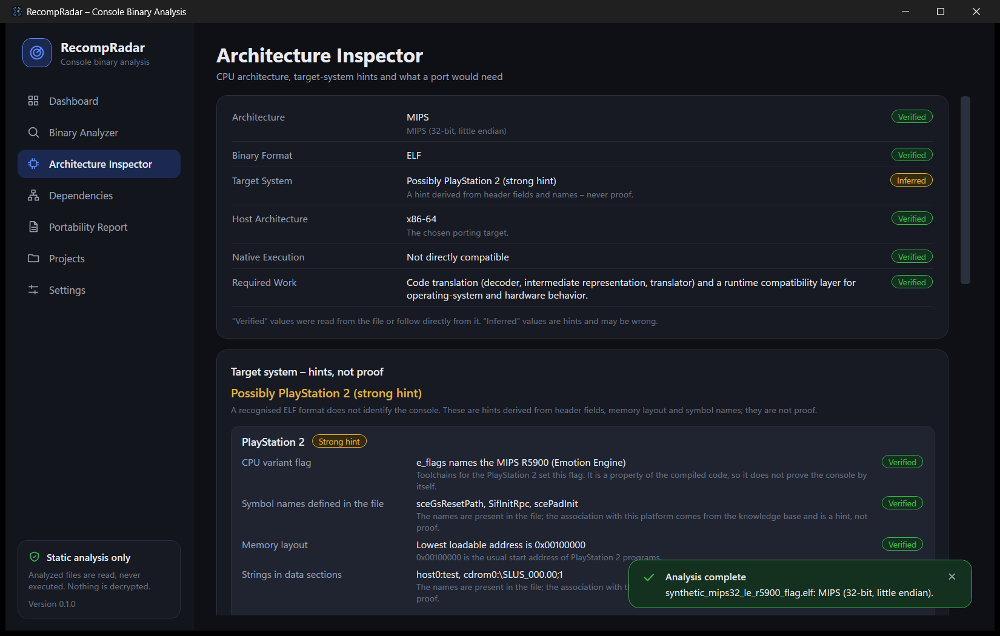
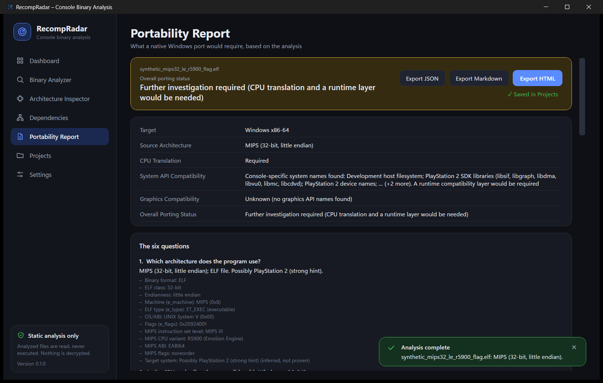

<p align="center">
  
</p>

<h1 align="center">RecompRadar</h1>
<p align="center"><strong>Console Binary Analysis and Native Portability Research Tool</strong></p>

RecompRadar inspects executable files of console programs and tells you, from facts found in the file, **what a native
Windows port would require**: which CPU architecture the code uses, whether it can run on a PC processor at all, which
libraries and APIs it refers to, and which information is still missing.

> **RecompRadar is an analysis tool, not a universal console recompiler.**
> It does not run, decrypt or convert console software, and it makes no promise that any commercial game can be ported or
> started. The recompilation code in this repository is a small, honest proof of concept for self-made test programs
> (see [docs/plugins.md](docs/plugins.md)).

<p align="center">
  
  
</p>

All screenshots in this repository were produced by the real application with `tools/capture-screenshots.ps1`, using the
synthetic files from `samples/`.

## Contents

* [Features](#features) · [What it does not do](#what-it-does-not-do) · [Supported formats](#supported-formats)
* [Install and run](#install-and-run) · [Build](#build) · [Tests](#tests)
* [Using the app](#using-the-app) · [How to read the results](#how-to-read-the-results)
* [Project architecture](#project-architecture) · [Technical limitations](#technical-limitations) · [Roadmap](#roadmap)
* [Safety and legal](#safety-and-legal) · [Kurzanleitung (Deutsch)](#kurzanleitung-deutsch)

## Features

Everything listed here is implemented and covered by automated tests.

**Binary Analyzer**
* Opens a file by dialog, drag and drop (onto any page or the whole window) or command line.
* Parses ELF32/ELF64, little and big endian: header, program headers (segments), section headers, `.symtab`/`.dynsym`
  symbols (type, binding, visibility, section), dynamic section (`DT_NEEDED`, `DT_SONAME`, `RPATH`/`RUNPATH`, interpreter),
  extended section numbering, entry point and where it lies.
* Builds the list of executable code regions and memory regions from segments and allocated sections.
* Works without section headers (stripped files): libraries are still found through the dynamic segment.
* Computes the SHA-256 of the file, shows progress and can be cancelled.
* Handles damaged, truncated and unknown files without crashing and explains each problem in plain language.

**Architecture Inspector**
* CPU family, word size, endianness, ISA level and ABI details from `e_flags` (for MIPS, for example MIPS III, EABI64, R5900 flag).
* Clear separation of **Verified** facts (read from the file), **Inferred** hints and **Unknown** values.
* Target-system hints (PlayStation 1/2/3/4, PSP, GameCube, Wii, plain Linux) from header flags, memory layout and symbol or
  string names – always graded *weak / moderate / strong* and always labelled as hints, never as identification.
* Compatibility with the porting target (Windows x86-64) and the work that follows from it.
* Entry-point preview from the MIPS32 proof-of-concept decoder, when a plugin supports the file.

**Dependency Analyzer**
* Needed shared libraries, imported and exported symbols, symbols defined in statically linked code.
* An extensible JSON knowledge base of public API, library and device names ([docs/knowledge-base.md](docs/knowledge-base.md)).
* String scan of data sections for device paths and mount points; hardware-access hints (`ioctl`, `/dev/mem`, ...).
* Says explicitly when there are no symbols. Nothing is guessed to fill the gap.

**Portability Report**
* Answers six questions: architecture, CPU compatibility, visible dependencies, missing information, runtime components,
  work steps – plus *Target / Source Architecture / CPU Translation / System API / Graphics / Overall status*.
* No percentages, no guarantees. Typical status: *Further investigation required*.
* Export as **JSON** (complete data), **Markdown** and a self-contained **HTML** page with tables.

**Projects**
* Every successfully analyzed file is stored in a local SQLite database: name, file name and path, SHA-256, size, analysis
  time, architecture, format, status, hints, notes and the path of the last exported report.
* The analyzed file is **not** copied. Analyzing the same file again refreshes its project and keeps name and notes.
* Reopen, rename, annotate, search and delete projects.

**Engineering**
* Asynchronous analysis with progress and cancellation; structured JSON-lines logging (Serilog).
* Dark, rounded UI with sidebar navigation, animated page changes and toggles (can be switched off).
* Recompiler plugin interfaces (loader, decoder, IR, translator, runtime layer, backend) and a MIPS32 proof of concept.

## What it does not do

* It does not run analyzed files, and it has no "run", "play" or "recompile" button – nothing it could honestly offer.
* It does not decrypt, unpack or circumvent protection. Encrypted containers (SELF, `~PSP`, PBP) are only *recognised*.
* It does not disassemble whole programs, recover control flow or find function boundaries (yet).
* It does not know which console a file is for; it reports hints.
* It does not translate commercial software. The MIPS proof of concept runs only small integer programs.

## Supported formats

| Format | Status |
| --- | --- |
| ELF32 / ELF64, little / big endian, any machine | Analyzed (executables, shared objects, relocatable objects) |
| x86, x86-64, MIPS, PowerPC (32/64), ARM, AArch64, RISC-V, Cell SPU | Named and assessed; other machines are listed as unknown, never guessed |
| PS-X EXE, PBP, `~PSP`, SCE/SELF, PE, Mach-O, gzip, ZIP | Recognised by signature, reported as unsupported with an explanation |
| DOL, XEX, NSO and others | Not recognised (reported as "unknown format") |

An ELF file does not name its console. RecompRadar never treats "it is an ELF" as "it is console X".

## Install and run

**Requirements:** Windows 10 or Windows 11, x64 (developed and tested on Windows 11). To build you need the
[.NET 10 SDK](https://dotnet.microsoft.com/download). To run a published build without the SDK, the .NET 10 Desktop
Runtime is enough.

```powershell
git clone https://github.com/FC6446/RecompRadar.git
cd RecompRadar
dotnet run --project src/RecompRadar.App -c Release
```

Or build once and start the executable:

```powershell
dotnet build RecompRadar.sln -c Release
.\src\RecompRadar.App\bin\Release\net10.0-windows\RecompRadar.exe
```

A framework-dependent, ready-to-copy build:

```powershell
dotnet publish src/RecompRadar.App -c Release -r win-x64 --self-contained false -o publish
.\publish\RecompRadar.exe
```

**Command line:** `RecompRadar.exe [file] [--page=dashboard|analyzer|architecture|dependencies|report|projects|settings]`
analyzes `file` right away and optionally opens a page. The file is only read.

**Try it:** the `samples/` folder has small synthetic ELF files (and deliberately damaged ones). Drop one onto the window.
See [samples/README.md](samples/README.md).

**Where data is stored:** `%LOCALAPPDATA%\RecompRadar` – `recompradar.db` (projects), `settings.json`, `knowledge\`
(extra knowledge-base files) and `logs\` (daily JSON-lines logs). Set `RECOMPRADAR_DATA_DIR` to use another folder.

## Build

```powershell
dotnet restore
dotnet build RecompRadar.sln -c Release
```

The WPF project (`RecompRadar.App`) and its test project target `net10.0-windows` and can only be built on Windows. All other
projects target `net10.0` and build on any platform. On Linux or macOS build the libraries and run their tests with
`dotnet test tests/RecompRadar.Tests`; the WPF app and `RecompRadar.App.Tests` cannot be built there.

## Tests

```powershell
dotnet test RecompRadar.sln -c Release
```

There are two xUnit projects, together **226 tests** that run in about ten seconds:

* `tests/RecompRadar.Tests` (199 tests, any platform) covers the analysis core, storage, export and the recompilation proof of concept.
* `tests/RecompRadar.App.Tests` (27 tests, Windows only) runs the real view models against the real pipeline and a temporary SQLite database, feeds real drag-and-drop events into the `FileDrop` behavior, and loads every page of the real window for every sample while failing on any XAML or binding error.

Together they cover:

* valid ELF files for 32/64-bit and little/big endian across x86, x86-64, MIPS, PowerPC, ARM, AArch64 and RISC-V;
* invalid input: empty, tiny, wrong magic, bad class/endianness, truncation at *every* possible length, forged offsets, sizes
  and counts, overflowing addresses, segments and sections outside the file, unterminated strings, 3 000 seeded random
  mutations of the sample files, and a full-pipeline mutation run;
* missing symbol tables, missing section headers, vendor-specific types and OS/ABI values;
* architecture assessment, platform hints (including that weak evidence never yields a strong hint), dependency matching,
  knowledge-base merging and damaged knowledge-base files;
* report building (including "no percentages, no guarantees"), JSON/Markdown/HTML export (including hostile names), atomic file writes;
* SQLite storage: round trips, upsert behaviour, damaged data, newer schema, concurrency, "the analyzed file is not copied";
* the recompilation proof of concept: decoding, delay-slot semantics, loads/stores in both byte orders, faults, limits;
* that the committed files in `samples/` equal what the generator produces, and that the intact samples give no warnings.

Not covered automatically: how the UI *looks* and a real mouse drag from Windows Explorer (the drop events themselves are tested). The
application was started and inspected for real; the screenshots in `docs/screenshots` come from it.

## Using the app

| Page | What you can do |
| --- | --- |
| **Dashboard** | Drop or open a file, see project statistics, recent projects and what RecompRadar can and cannot do |
| **Binary Analyzer** | Header, segments, sections, symbols (filter, imports only), memory regions, diagnostics |
| **Architecture Inspector** | Verified facts, target-system hints with reasons and caveats, translation notes, entry-point preview |
| **Dependencies** | Known APIs, libraries, imported symbols (filter), hardware hints, notes |
| **Portability Report** | The report, export as JSON / Markdown / HTML, save as project |
| **Projects** | Reopen, rename, annotate, search and delete saved analyses |
| **Settings** | File size limit, auto-saving, export folder, knowledge-base folder, animations; data locations |

## How to read the results

* **Verified** (green) – read from the file or following directly from it.
* **Inferred** (amber) – a hint. Strength *weak / moderate / strong* says how much supporting evidence there is, not how likely
  it is to be right. Each hint lists its reasons and caveats.
* **Unknown** (grey) – could not be determined.
* **Overall porting status** is one of *Not analyzable*, *Further investigation required* (with the reason) or *CPU instruction set
  matches …*. There is intentionally no "compatible" and no percentage.

Example (shipped sample `synthetic_mips32_le_r5900_flag.elf`):

```
Target:                    Windows x86-64
Source Architecture:       MIPS (32-bit, little endian)
CPU Translation:           Required
System API Compatibility:  Console-specific system names found: ...; A runtime compatibility layer would be required
Graphics Compatibility:    Unknown (no graphics API names found)
Overall Porting Status:    Further investigation required (CPU translation and a runtime layer would be needed)
Target system (hint):      Possibly PlayStation 2 (strong hint) – from the R5900 CPU flag, SDK-style symbol names and addresses
```

## Project architecture

```
src/
  RecompRadar.Core            models, interfaces, limits (no dependencies)
  RecompRadar.BinaryAnalysis  ELF parser, format detection, knowledge base, dependency analysis
  RecompRadar.Architectures   CPU assessment, platform heuristics
  RecompRadar.Recompilation   plugin interfaces, IR, MIPS32 proof of concept
  RecompRadar.Portability     analysis pipeline, report builder, JSON/Markdown/HTML exporters
  RecompRadar.Infrastructure  SQLite store, settings, logging, paths
  RecompRadar.App             WPF application (MVVM)
tests/        RecompRadar.Tests, RecompRadar.App.Tests (WPF), RecompRadar.TestSupport (synthetic ELF builder, MIPS mini-assembler)
tools/        sample generator, icon and screenshot scripts
samples/      synthetic sample files
docs/         architecture, plugins, knowledge base, safety, screenshots
```

Technology: C#, .NET 10, WPF with MVVM ([CommunityToolkit.Mvvm](https://github.com/CommunityToolkit/dotnet)),
SQLite ([Microsoft.Data.Sqlite](https://learn.microsoft.com/dotnet/standard/data/sqlite/)), Serilog, xUnit. All
dependencies are MIT or Apache-2.0 licensed – see [THIRD-PARTY-NOTICES.md](THIRD-PARTY-NOTICES.md).
Details: [docs/architecture.md](docs/architecture.md).

C++ and LLVM are **not** required. The plugin interfaces in `RecompRadar.Recompilation` are the place where a native
backend (for example LLVM) would later attach.

## Technical limitations

* **ELF only.** Other executable formats are recognised but not parsed.
* **No disassembly beyond the MIPS32 integer subset.** Imports show that a name is *present*, not that it is *called*.
  Hardware access through fixed addresses cannot be seen without disassembly.
* **Platform hints are heuristics** built from public conventions (flags, address ranges, SDK names). Homebrew toolchains,
  other systems and deliberately disguised files can all produce false or missing hints. Some hint sources are shared by
  several platforms (for example `sceKernel*` names exist on PSP, Vita and PS4) and are rated accordingly.
* **Dynamic symbols without section headers** are not recovered (only `DT_NEEDED`, `DT_SONAME`, `RPATH`/`RUNPATH` and the
  interpreter are read through the dynamic segment).
* **Console-specific dynamic tags** (for example the `DT_SCE_*` range) are listed as raw entries; their meaning is not interpreted.
* **Large files:** by default files up to 2 GiB are accepted (configurable, max 16 GiB); symbols are capped at 500 000
  per table and the symbol list shows the first 200 000.
* **UI:** English only. Checked on Windows 11 at 125 % scaling; other scalings and Windows 10 are untested. Drag and drop from a
  non-elevated Explorer does not work onto an elevated (administrator) RecompRadar window – a Windows restriction; use *Open file…* then.
* **Windows only** for the application. The analysis libraries are cross-platform.

## Roadmap

1. **More input formats** as loader plugins: PS-X EXE (header only), DOL, PBP/PRX *after* the user supplies an unprotected module.
2. **Disassembly** with a decoder per architecture; call-site analysis so that imports can be reported as *used*.
3. **Control-flow and function discovery**, including for stripped binaries.
4. **Richer IR and a second proof of concept** (PowerPC or MIPS with HI/LO and FPU) validated against self-made programs.
5. **Native backend** behind `ICodeBackend` (LLVM IR emission), still verified against the reference interpreter.
6. **Runtime layers** behind `IRuntimeCompatibilityLayer` (system calls, graphics, audio, input) for open homebrew SDKs.
7. **Localisation** (German first), more export formats (SARIF/CSV), report comparison between two analyses.
8. **Signed releases** and a CI pipeline (build, test, publish).

## Safety and legal

RecompRadar analyzes files statically and never executes them. It contains no DRM circumvention and does not decrypt
protected console files. The repository contains no commercial games, BIOS images, firmware, keys or other protected
assets, and the knowledge base only holds plain public names. Use it only on files you are entitled to analyze.
Details: [docs/safety-and-legal.md](docs/safety-and-legal.md).

License: [MIT](LICENSE). Third-party components: [THIRD-PARTY-NOTICES.md](THIRD-PARTY-NOTICES.md).

---

## Kurzanleitung (Deutsch)

**Was ist das?** RecompRadar ist ein Windows-Programm, das ausführbare Dateien (ELF) von Konsolenprogrammen statisch
untersucht und aus tatsächlich gefundenen Fakten einen technischen Portierungsbericht erstellt. Es ist **kein**
Recompiler: Es startet, entschlüsselt oder übersetzt keine Konsolenspiele.

**Starten unter Windows 10/11 (x64):**

1. [.NET 10 SDK](https://dotnet.microsoft.com/download) installieren.
2. Im Projektordner `dotnet run --project src/RecompRadar.App -c Release` ausführen
   (oder `dotnet build RecompRadar.sln -c Release` und danach `src\RecompRadar.App\bin\Release\net10.0-windows\RecompRadar.exe` starten).
3. Eine Datei aus `samples\` auf das Fenster ziehen oder über *Open file…* öffnen.
4. Ergebnisse auf den Seiten *Binary Analyzer*, *Architecture Inspector*, *Dependencies* und *Portability Report* ansehen;
   den Bericht als JSON, Markdown oder HTML exportieren. Analysen werden unter *Projects* gespeichert.

**Tests:** `dotnet test RecompRadar.sln -c Release`. Die Oberfläche ist derzeit englisch.
